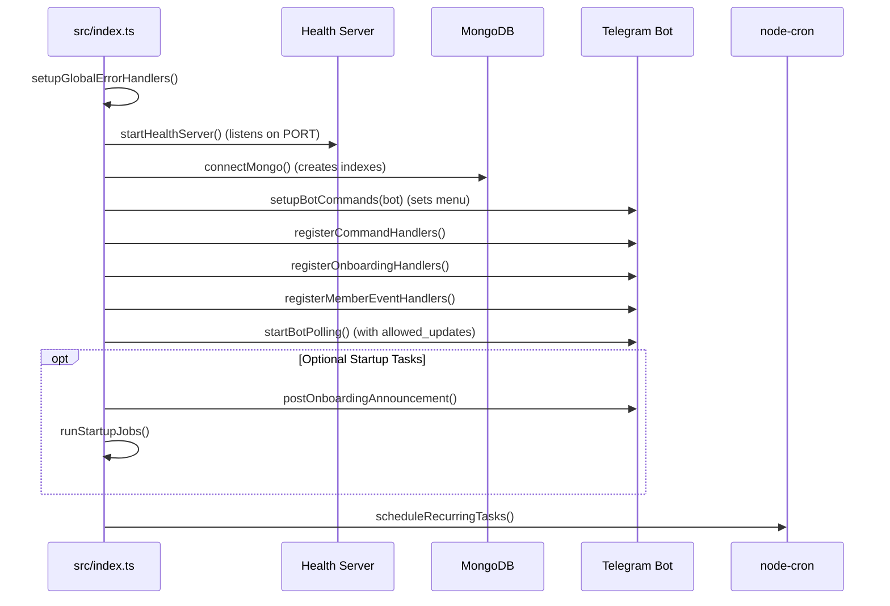
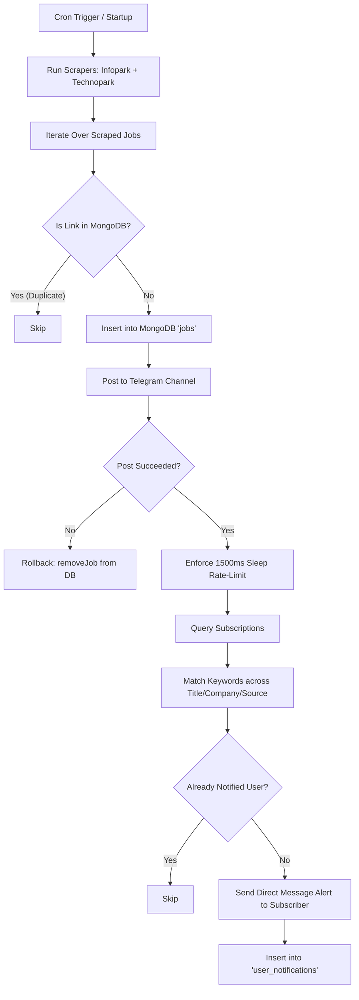

# 🏗️ Architecture & System Design

This document details the internal architecture, lifecycle flow, concurrency model, and fault-tolerance mechanisms of the **Kerala Job Alert Bot**.

---

## 1. Concurrency Model: Single Process, Multi-Service

The application runs as a **single Node.js ESM process** combining four asynchronous tasks without requiring external queue servers (like Redis or Celery):

```
+-------------------------------------------------------------------------+
|                         Node.js Process (ESM)                           |
|                                                                         |
|  1. Web & Dashboard Server   2. Telegram Bot Polling                    |
|     (node:http on PORT)         (node-telegram-bot-api)                 |
|     - /dashboard, /healthz      - Commands, Inline Buttons              |
|     - /api/stats REST API       - chat_member joins/leaves              |
|                                                                         |
|  3. Cron Scheduler           4. Scraping & Notification Pipeline        |
|     (node-cron)                 (Cheerio + Axios + MongoDB)             |
|     - Recurring job runs        - Multi-source scraper                  |
|     - Analytics summaries       - Personal alert matching & DM delivery |
+-------------------------------------------------------------------------+
                                    │
                                    ▼
                         ┌─────────────────────┐
                         │   MongoDB Cluster   │
                         └─────────────────────┘
```

### Why this design?
- **Zero Extra Infrastructure Costs**: Runs entirely on a single DigitalOcean basic container (`apps-s-1vcpu-0.5gb`).
- **Unified State**: The dashboard immediately accesses in-memory process telemetry and real-time MongoDB query results without inter-process communication overhead.
- **Port-Binding Compliance**: Satisfies cloud platform health probes (DigitalOcean App Platform, Render) while actively polling Telegram.

---

## 2. Application Startup Sequence

The entry point is located in [`src/index.ts`](file:///Users/nevin/code/personal/kerala-job-alert-bot/src/index.ts). The boot lifecycle executes in strict order:



1. **Global Error Handlers**: Catches `uncaughtException` and `unhandledRejection` to prevent unhandled promise drops from crashing the server.
2. **Health Server**: Binds immediately to `PORT` so cloud health checks pass during container initialization.
3. **Database Connection**: Connects to MongoDB and enforces indexes on:
   - `jobs.link` (unique)
   - `subscriptions.chatId` (unique)
   - `user_notifications.(chatId, link)` (unique compound)
   - `telegram_users.userId` (unique)
   - `member_events.createdAt`
   - `analytics_events.ts`
4. **Command Registration**: Registers interactive buttons and calls `bot.setMyCommands()` to update Telegram's native command autocomplete menu.
5. **Event Handlers**: Attaches listeners for messages, callbacks, and channel join/leave events (`chat_member`, `new_chat_members`, `my_chat_member`).
6. **Polling Startup**: Cleans lingering webhooks (`deleteWebHook()`) and starts polling with `allowed_updates`.
7. **Scheduler**: Initializes `node-cron` schedules for regular scraping and analytics reports.

---

## 3. Scraping & Notification Pipeline

The scraper execution pipeline is handled in [`src/jobs/runner.ts`](file:///Users/nevin/code/personal/kerala-job-alert-bot/src/jobs/runner.ts):



### Scraping Invariants
- **Primary Stable Key**: The job URL (`link`) is the absolute identifier.
- **Idempotency via MongoDB**: Inserting a job with an existing `link` throws MongoDB error code `11000` (Duplicate Key), which is handled cleanly as a no-op skip.
- **Fail-Safe Rollback**: If a Telegram broadcast fails permanently, [`removeJob(job.link)`](file:///Users/nevin/code/personal/kerala-job-alert-bot/src/db/jobs.ts) deletes the MongoDB record, ensuring it will be re-attempted during the next scrape run rather than permanently dropped.

---

## 4. Rate Limiting & Resilience

### Telegram Channel Rate Limiting
- Telegram enforces a channel broadcast limit of ~20-30 messages per minute.
- `src/jobs/runner.ts` enforces a strict **1500ms sleep** between consecutive channel posts.
- If Telegram returns HTTP **`429 Too Many Requests`**, the runner parses `parameters.retry_after`, sleeps for the requested duration plus a jitter margin, and automatically retries.

### Rolling Deploys & 409 Conflict Handling
- During container deployments on DigitalOcean App Platform, the old container and the new container briefly overlap for 10-30 seconds.
- The new container will catch a temporary:
  ```
  409 Conflict: terminated by other getUpdates request
  ```
- [`src/telegram/bot.ts`](file:///Users/nevin/code/personal/kerala-job-alert-bot/src/telegram/bot.ts) intercepts `409 Conflict` errors and schedules a polling restart with exponential backoff (starting at 10s up to 60s). As soon as the old container terminates, polling resumes automatically without service disruption.
